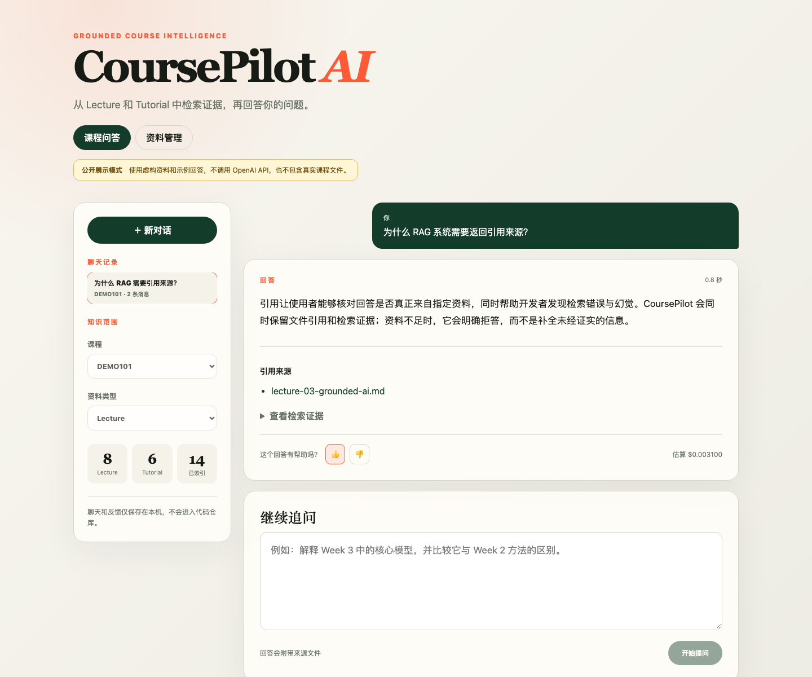
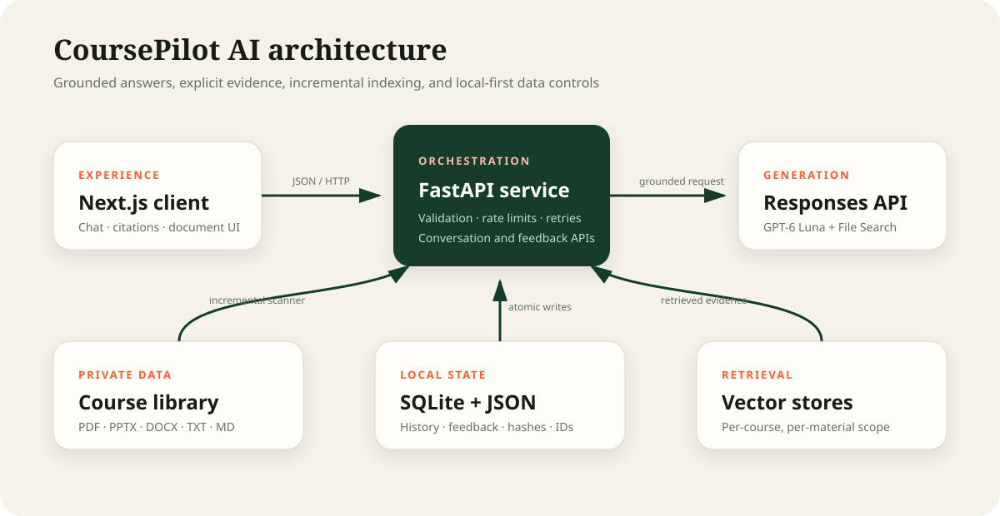

# CoursePilot AI

[](https://github.com/11181658132/coursepilot-ai/actions/workflows/ci.yml)

CoursePilot AI is a grounded course knowledge base that turns lecture and tutorial
files into answers with inspectable citations. It combines a FastAPI orchestration
layer, a Next.js interface, OpenAI Responses + File Search, incremental indexing,
evaluation, and privacy-conscious local persistence.

> The public portfolio preview uses fictional material and canned answers. It never
> sends a request to OpenAI and contains no university course files. The real local
> application uses the same interface with live retrieval.



## Why this project is more than a chatbot

| Area | Implementation |
| --- | --- |
| Grounding | Separate vector stores by course and material type, retrieved evidence, file citations, and explicit refusal instructions |
| Ingestion | PDF/PPTX/DOCX/TXT/MD discovery, SHA-256 change detection, incremental upload, replacement, deletion, and index preview |
| Product | Course filters, lecture/tutorial scope, multi-turn history, source inspection, feedback, document management, and responsive UI |
| Safety | File extension/signature/size/path validation, prompt-injection resistance, bounded retries, and per-client rate limits |
| Evaluation | 13 labelled bilingual cases covering retrieval, concepts, refusals, citations, latency, token usage, and cost |
| Engineering | Typed API models, 20 backend tests, frontend type checking/build, Docker development, and GitHub Actions CI |
| Privacy | API keys, raw course files, telemetry, conversations, and remote index state are excluded from Git |

## Architecture



The backend deliberately owns retrieval and secrets. The browser never receives
the OpenAI API key. Each `course:material_type` combination maps to a separate
vector store, and local hashes prevent unchanged files from being uploaded twice.
See [the architecture notes](docs/architecture.md) for the request and ingestion
flows and their trade-offs.

## Evaluation snapshot

The checked-in dataset contains 13 cases across three courses:

- grounded factual questions with expected source files and bilingual concepts;
- questions that are intentionally unanswerable from the course material;
- a direct prompt-injection attempt requesting the system prompt and API key.

The latest completed low-cost smoke sample passed **3/3** cases with **100% retrieval
hit rate**, **100% citation precision**, and **100% keyword recall**. A full run can
be resumed without paying for completed cases. Generated reports remain local
because they can contain course-derived answers and filenames.

```bash
cd backend
python -m app.cli eval --resume
```

The evaluator writes machine-readable JSON and a standalone HTML dashboard to
`evals/reports/`. Its estimated cost combines model-token usage with the number
of hosted File Search calls; both prices remain configurable because rates change.

## Run the real application locally

### 1. Configure secrets

```bash
cp .env.example .env
```

Set `OPENAI_API_KEY` and `KNOWLEDGE_BASE_DIR` in `.env`. Never paste a real key
into source code or commit it.

The scanner discovers course names dynamically and expects this shape:

```text
knowledge-base/
├── 90016/
│   ├── lecture/
│   └── tutorial/
└── 90049/
    ├── lecture/
    └── tutorial/
```

Files containing `tute` or `tutorial` are classified as tutorial material even
when they are outside a tutorial folder.

### 2. Start the backend

```bash
python3 -m venv .venv
source .venv/bin/activate
pip install -r backend/requirements.txt
uvicorn app.main:app --app-dir backend --reload --port 8000
```

### 3. Start the frontend

Node.js 20+ is required.

```bash
cd frontend
cp .env.local.example .env.local
npm install
npm run dev
```

Open <http://localhost:3000>. Interactive backend documentation is available at
<http://localhost:8000/docs>.

## Index documents

Previewing is local and free:

```bash
cd backend
python -m app.cli sync --dry-run
```

Run the actual sync only for material you are allowed to process:

```bash
python -m app.cli sync
```

Subsequent runs skip unchanged files. New and changed documents are sent to an
OpenAI vector store and can incur API storage/processing charges.

## Safe portfolio preview

The frontend includes an explicit read-only mode for public deployment. It uses
fictional files and example responses, disables destructive document operations,
and makes no backend or OpenAI requests.

```bash
cd frontend
NEXT_PUBLIC_DEMO_MODE=true npm run dev
```

For a Vercel preview, set the project root to `frontend` and add:

```text
NEXT_PUBLIC_DEMO_MODE=true
```

No `OPENAI_API_KEY` is needed for this mode.

## Tests

```bash
python -m unittest discover -s backend/tests -v
cd frontend && npm run typecheck && npm run build
```

GitHub Actions repeats these checks on every push and pull request.

## API surface

- `GET /health` — readiness check
- `GET /api/courses` — course inventory and index status
- `GET /api/documents` — local and indexed document inventory
- `POST /api/documents/upload` — validated local upload
- `DELETE /api/documents` — explicit local and remote deletion
- `POST /api/sync/preview` — pending index changes without upload
- `POST /api/sync` — incremental synchronization
- `POST /api/chat` — grounded question answering
- `GET /api/conversations` — conversation history
- `GET /api/conversations/{id}/messages` — conversation messages
- `POST /api/feedback` — human feedback for an answer

## Design decisions and limitations

- Hosted File Search made the first reliable baseline fast to build. A pgvector
  implementation would provide more control over chunking, hybrid retrieval, and
  reranking and is the next retrieval experiment.
- Conversation history is intentionally local-first. A multi-user deployment
  needs authentication, PostgreSQL, tenant isolation, migrations, and backups.
- Public live inference is not enabled: exposing an unauthenticated API would risk
  API-key abuse and could redistribute course content. The public preview is safe
  and static; the full RAG workflow is demonstrated locally.

## Roadmap

1. Compare hosted File Search with PostgreSQL/pgvector hybrid retrieval and reranking.
2. Add page-level PDF extraction and page citations.
3. Calibrate a model-graded faithfulness metric against human labels.
4. Add authentication, tenant isolation, durable cloud storage, and observability.
